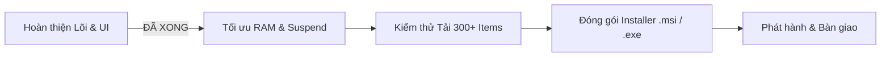

# KẾ HOẠCH & BÁO CÁO TIẾN ĐỘ: DESKTOP MENU LAUNCHER

*(Phiên bản v5 — Cập nhật thực tế theo hiện trạng dự án | Tauri 2.x + React 19 + TailwindCSS v4)*

> **Cập nhật ngày:** 20/08/2026  
> **Trạng thái tổng thể:** Hoàn thành toàn bộ lõi tính năng MVP, hệ thống Phím tắt toàn cầu nâng cao, Quản lý nhóm & kéo thả, Giao diện tối ưu hiệu năng. Sẵn sàng cho giai đoạn kiểm thử đóng gói.

---

## 0. Tóm tắt Quyết định Kiến trúc & Hiện trạng Công nghệ

| Hạng mục | Công nghệ & Giải pháp thực tế | Trạng thái |
| :--- | :--- | :---: |
| **Hệ điều hành** | Windows 10 / 11 (64-bit) — Yêu cầu Edge WebView2 Runtime | ✅ Chuẩn hóa |
| **Nền tảng ứng dụng** | **Tauri 2.x** (Rust core + Webview) | ✅ Đã cấu hình |
| **Backend Core** | **Rust**, Crate `windows` (Win32 API chuẩn) + `tokio` async | ✅ Hoàn thành |
| **Frontend Framework** | **React 19** + **TypeScript** + **Vite** (HMR) | ✅ Hoàn thành |
| **Giao diện & Styling** | **TailwindCSS v4** + Warm Editorial & Glassmorphism Design System | ✅ Hoàn thành |
| **Hiệu năng danh sách** | `@tanstack/react-virtual` (Ảo hóa DOM > 200 mục) | ✅ Hoàn thành |
| **Phím tắt toàn cầu** | `tauri-plugin-global-shortcut` + **Win32 Window Subclassing** chặn menu hệ thống | ✅ Hoàn thành |
| **Lưu trữ & An toàn** | `%AppData%\DesktopMenuLauncher\` (`menu_data.json`), ghi Atomic chống hỏng file | ✅ Hoàn thành |
| **Quản lý Nhóm & Item** | Entity Nhóm riêng biệt, hỗ trợ Kéo - Thả file trực tiếp từ Explorer | ✅ Hoàn thành |
| **Trích xuất Icon** | `PrivateExtractIconsW` (256x256 high-res) lưu PNG cache tại `%AppData%` | ✅ Hoàn thành |
| **Khởi động cùng Win** | `tauri-plugin-autostart` (Tùy chọn bật/tắt trong Cài đặt) | ✅ Hoàn thành |
| **Single Instance** | `tauri-plugin-single-instance` (Tự kích hoạt cửa sổ khi mở lần 2) | ✅ Hoàn thành |
| **System Tray** | Tray icon với menu: Mở Menu, Cài đặt, Thoát (ẩn khi đóng) | ✅ Hoàn thành |
| **Chế độ Giao diện** | Dark Mode / Light Mode với animation chuyển mượt mà | ✅ Hoàn thành |

---

### 1.1. Sidebar (Danh mục / Nhóm)

- Danh sách nhóm linh hoạt với số lượng mục trong từng nhóm.
- Chức năng: Thêm nhóm mới, chỉnh sửa tên/màu sắc/icon, xóa nhóm (chuyển mục sang nhóm khác hoặc xóa cùng mục).
- Nhóm mặc định "Khác" luôn hiện diện để gom các mục chưa phân loại.

### 1.2. Content Area (Khu vực nội dung & Thao tác)

- **Thanh công cụ trên:**
  - Ô tìm kiếm thông minh (tự động focus, lọc tức thì).
  - Nút chuyển đổi giao diện Lưới (Grid) / Danh sách (List).
  - Nút Thêm mục nhanh (chọn 1 hoặc nhiều file qua hộp thoại Windows).
  - Nút Cài đặt (mở Modal cấu hình toàn diện).
- **Vùng hiển thị danh sách (Virtualized):**
  - Hiển thị icon sắc nét, tên ứng dụng và trạng thái tồn tại.
  - Menu chuột phải (Context Menu): Mở, Mở thư mục chứa file, Đổi tên, Đổi icon, Xóa khỏi danh sách.
  - Hỗ trợ Kéo - Thả file từ Windows Explorer vào ứng dụng để tự nhận diện và thêm tức thì.

---

## 2. Chi tiết Tiến độ Tính năng & Hiện trạng Triển khai

### 2.1. Quản lý Mục & Kéo thả (Item Manager) — `100% Hoàn thành`

- [x] Thêm file thực thi (`.exe`, `.lnk`, `.bat`, `.cmd`, `.ps1`), thư mục, tài liệu bất kỳ.
- [x] Tự động trích xuất icon chất lượng cao và lưu cache PNG.
- [x] Thêm hàng loạt file cùng lúc qua Open File Dialog.
- [x] Kéo thả (Drag & Drop) trực tiếp từ Desktop/Explorer vào giao diện.
- [x] Đổi tên hiển thị (không ảnh hưởng tên file gốc).
- [x] Xóa mục khỏi menu với hộp thoại xác nhận và Toast thông báo có hỗ trợ "Hoàn tác" (Undo).
- [x] Mở ứng dụng/tài liệu qua Windows `ShellExecuteW`.
- [x] Mở vị trí thư mục chứa file (`explorer /select,...`).

### 2.2. Quản lý Nhóm (Grouping System) — `100% Hoàn thành`

- [x] Nhóm là Entity độc lập trong `menu_data.json` với `id`, `name`, `icon`, `color`, `order`.
- [x] Modal thêm nhóm và chỉnh sửa nhóm tùy biến cao.
- [x] Xóa nhóm an toàn: Hỏi người dùng muốn chuyển các mục sang nhóm khác hay xóa toàn bộ.
- [x] Lọc danh sách theo nhóm được chọn tức thì.

### 2.3. Hệ thống Phím tắt Toàn cầu (Global Shortcut) — `100% Hoàn thành`

- [x] Khởi tạo `tauri-plugin-global-shortcut` trên Tauri v2.
- [x] Hướng dẫn cài đặt phím tắt ngay lần đầu khởi chạy (`ShortcutSetupModal`).
- [x] Tùy chỉnh phím tắt trong `SettingsModal`:
  - Menu gợi ý chọn nhanh: `Ctrl + Shift + M` (Khuyên dùng), `Alt + M`, `F12`.
  - Chế độ tự nhập tùy biến: Cho phép bất kỳ tổ hợp phím hoặc 1 phím đơn lẻ (như `F12`, `A`, `Space`,...).
- [x] **Xử lý triệt để lỗi nuốt phím & xung đột Windows:**
  - Tạm ngắt phím tắt hiện tại khi bắt đầu ghi nhận phím mới (`unregisterGlobalShortcut`) để Windows không chặn keystroke.
  - Hỗ trợ thoát chế độ ghi nhận an toàn bằng Click Outside hoặc phím hủy.
  - Tự động khôi phục phím tắt cũ nếu đăng ký phím mới thất bại hoặc không hợp lệ.
  - Rust Window Subclassing chặn thông điệp `SC_KEYMENU` (ngăn Windows bật System Menu khi ấn `Alt` / `Alt + Space`).

### 2.4. Quản lý Trạng thái & Độ tin cậy Dữ liệu (Backend Core) — `100% Hoàn thành`

- [x] `AppState` quản lý qua `RwLock<MenuData>` đa luồng an toàn.
- [x] Đọc/ghi `menu_data.json` theo cơ chế **Atomic Write** (ghi file tạm `.tmp` rồi đổi tên) chống hỏng file khi tắt máy đột ngột.
- [x] Tự động tạo thư mục dữ liệu tại `%AppData%\DesktopMenuLauncher\`.
- [x] Kiểm tra tính hợp lệ đường dẫn file (`ton_tai`) và làm mờ các mục bị mất file gốc.
- [x] Nút "Quét lại dữ liệu" thủ công trong Cài đặt.

### 2.5. Hệ thống Giao diện & Trải nghiệm (UI/UX) — `100% Hoàn thành`

- [x] Thiết kế chuẩn Warm Editorial kết hợp hiệu ứng Glassmorphism hiện đại.
- [x] Hệ thống Toast thông báo trạng thái (Thành công, Lỗi, Cảnh báo, Thông tin).
- [x] Modal xác nhận xóa / tùy chỉnh thay thế hoàn toàn dialog native thô sơ.
- [x] Chế độ Sáng / Tối (Dark / Light Theme) chuyển đổi mượt mà.
- [x] Luôn nổi trên các cửa sổ khác (Always on Top) có thể bật/tắt trong cài đặt.
- [x] Khởi động cùng Windows (Autostart).

---

## 3. Cấu trúc Dự án Thực tế (Feature-Sliced Design)

```
Menu-Launcher/
├── 📁 src-tauri/                         # [BACKEND RUST]
│   ├── Cargo.toml
│   ├── tauri.conf.json                  # Cấu hình cửa sổ, plugin, capabilities
│   ├── capabilities/                    # Quyền Tauri 2.x (default.json)
│   └── src/
│       ├── main.rs                      # Entry point
│       ├── lib.rs                       # Setup Window, Subclassing chặn SC_KEYMENU, Plugin init
│       ├── core/
│       │   ├── data_service.rs          # Quản lý AppState, Atomic IO, MenuData struct
│       │   └── mod.rs
│       ├── platform/
│       │   ├── icon_extractor.rs        # Trích xuất icon 256x256 (PrivateExtractIconsW)
│       │   ├── file_operations.rs       # ShellExecuteW, mở thư mục
│       │   └── mod.rs
│       └── ipc_commands/
│           ├── item_commands.rs         # get_all_items, add_item, delete_item, open_item...
│           ├── group_commands.rs        # add_group, edit_group, delete_group...
│           ├── settings_commands.rs     # register_global_shortcut, autostart, rescan...
│           └── mod.rs
│
├── 📁 src/                              # [FRONTEND REACT + TS]
│   ├── App.tsx                          # Root component
│   ├── main.tsx
│   ├── index.css                        # TailwindCSS v4 theme variables
│   ├── api/
│   │   └── index.ts                     # Wrapper gọi Tauri Invoke
│   ├── layouts/
│   │   ├── MainWindow.tsx               # Khung chính 2 cột, xử lý Drag-Drop & Hotkey
│   │   ├── Sidebar.tsx                  # Danh mục nhóm, nút thêm nhóm
│   │   └── ContentArea.tsx              # Grid/List Ảo hóa, Toolbar, ContextMenu
│   ├── features/
│   │   ├── Settings/
│   │   │   ├── SettingsModal.tsx        # Cài đặt phím tắt, giao diện, autostart
│   │   │   └── ShortcutSetupModal.tsx   # Modal hướng dẫn phím tắt lần đầu
│   │   ├── Items/                       # Modal thêm/sửa mục, ItemCard, ItemRow
│   │   └── Groups/                      # Modal tạo/sửa nhóm
│   ├── components/                      # ConfirmDialog, ToastContainer, Dropdown...
│   ├── hooks/                           # useTheme, useVirtualizer, useNotification...
│   └── types/                           # Item, Group, Settings type definitions
│
├── 📁 docs/                             # [TÀI LIỆU DỰ ÁN]
│   ├── INDEX.md                         # Bản đồ tài liệu
│   ├── PROJECT_CONTEXT.md               # Bối cảnh & Hiện trạng cập nhật
│   └── plan/
│       └── Ke_Hoach_Desktop_Menu_Launcher_Tauri_v3.md # Kế hoạch & Báo cáo tổng thể này
│
└── package.json
```

---

## 4. Kế hoạch Các bước Tiếp theo (Giai đoạn Hoàn thiện & Đóng gói)



### Hạng mục cần thực hiện tiếp

1. **Kiểm thử hiệu năng & Tải nặng (Soak & Stress Test):**
   - Sinh script dữ liệu thử nghiệm 300+ mục để đo độ mượt khi cuộn và tìm kiếm tức thì.
   - Kiểm tra mức tiêu thụ RAM khi app ẩn xuống System Tray trong thời gian dài.
2. **Tối ưu hóa WebView2 Suspend (Nếu cần):**
   - Đánh giá tính ổn định khi gọi API giải phóng RAM lúc cửa sổ ẩn.
3. **Đóng gói sản phẩm (Build & Bundle):**
   - Tạo file cài đặt `.msi` và bản Portable `.exe` độc lập bằng Tauri Bundler.
   - Soạn thảo tài liệu hướng dẫn sử dụng và hướng dẫn vượt cảnh báo Windows SmartScreen cho người dùng cuối.
